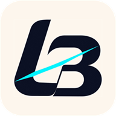
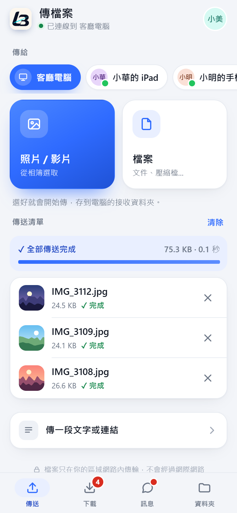
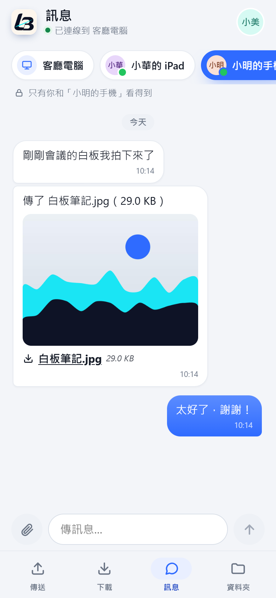
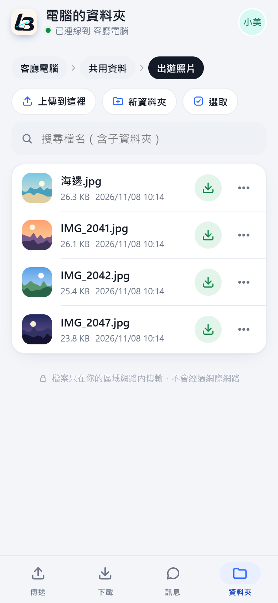

  

<h1 align="center">LANBeam 區網快傳</h1>

<b>同一個 Wi-Fi，檔案直接到。</b> 
Windows 電腦和手機在同一個網路裡互傳檔案、照片和訊息。電腦裝一次，手機掃 QR code 就能用；不用帳號，檔案不經過網際網路。

  <a href="https://github.com/Yangjianzin/LANBeam/releases/latest/download/LANBeam-Setup.exe"><b>⬇ 下載 Windows 版</b></a>
  &nbsp;·&nbsp;
  <a href="https://yangjianzin.github.io/LANBeam/">介紹網站</a>
  &nbsp;·&nbsp;
  <a href="https://github.com/Yangjianzin/LANBeam/releases">所有版本</a>

  
  
  

<table>
  <tr>
    <td align="center" width="33%">
      <picture>
        <source media="(prefers-color-scheme: dark)" srcset="img/dark-send.png">
        
      </picture>
       <b>選照片就傳</b>
    </td>
    <td align="center" width="33%">
      <picture>
        <source media="(prefers-color-scheme: dark)" srcset="img/dark-chat.png">
        
      </picture>
       <b>手機和手機也能傳</b>
    </td>
    <td align="center" width="33%">
      <picture>
        <source media="(prefers-color-scheme: dark)" srcset="img/dark-files.png">
        
      </picture>
       <b>翻電腦的資料夾</b>
    </td>
  </tr>
</table>

## 三個步驟開始

1. **在電腦裝好 LANBeam**：執行安裝檔，裝好打開。同一個網路裡也開著 LANBeam 的電腦會自動出現，不用查 IP。
2. **手機掃 QR code**：在電腦按「和手機互傳」，用手機相機掃畫面上的 QR code，瀏覽器就會打開，不用裝 App。
3. **拖過去，或選照片**：電腦把檔案拖到對方的電腦卡片上；手機選好照片或影片就開始傳。

## 電腦對電腦

- **自動找到對方**：開著 LANBeam 的電腦會排成卡片，點卡片選檔案，或直接把檔案拖上去。
- **整個資料夾也行**：檔案、資料夾一起傳；在檔案總管按右鍵「傳送到」也找得到 LANBeam。
- **信任的電腦免確認**：第一次收到時會先問你；勾了「信任」，之後那台電腦傳來的就直接收下。
- **斷線接著傳**：大檔案傳到一半網路斷了，重新連上會從斷掉的地方繼續。
- **剪貼簿互通**：開啟後，在另一台電腦按 <kbd>Ctrl</kbd>+<kbd>Alt</kbd>+<kbd>Shift</kbd>+<kbd>V</kbd>，就貼上這台複製的文字、圖片或檔案。
- **順便傳個訊息**：電腦之間可以直接聊幾句，傳過的檔案也會出現在對話裡。
- **連不上自己檢查**：找不到對方時會檢查防火牆與網路設定，能修的一鍵修好。
- **邀請另一台電腦**：按「邀請」，對方打開網址就能直接從你的電腦下載安裝檔。

## 手機（免裝 App）

- **選照片就傳**：選好照片、影片馬上開始傳，大檔案斷線會接著傳；也可以改傳給別支手機。
- **下載電腦給你的檔案**：電腦加入的檔案會出現在「下載」，有新的會標出來。
- **手機之間互傳**：傳檔案、傳私訊給其他手機，經過電腦轉送，只有你們兩個看得到。
- **翻電腦的資料夾**：有縮圖、能搜尋，照片和 PDF 點了直接看，勾幾個一起打包下載。
- **像 App 一樣用**：在瀏覽器選「加到主畫面」，點圖示就能全螢幕打開；支援深色模式。

## 隱私

- 檔案只在你的區域網路裡傳，中間沒有伺服器、不上傳雲端，也不需要網際網路。
- 不用註冊帳號、不用登入。
- 設定配對碼後，手機要先輸入才能用；不認識的電腦傳檔來，也會先問過你。
- 電腦之間的傳輸預設加密；手機網頁也能改用 https。
- 在手機上刪除電腦裡的檔案，會移到電腦的資源回收筒，可以還原。

## 下載與安裝

- 系統需求：Windows 10 / 11（64 位元）。手機用 iPhone、Android 的瀏覽器就好。
- [下載最新版安裝檔](https://github.com/Yangjianzin/LANBeam/releases/latest/download/LANBeam-Setup.exe)，執行後照畫面安裝；不用另外裝其他東西。
- 執行安裝檔時如果出現「Windows 已保護您的電腦」，按「其他資訊」→「仍要執行」就能安裝。
- 每個版本的更新內容與檔案校驗值（SHA-256）在 [Releases](https://github.com/Yangjianzin/LANBeam/releases)。

## 常見問題

<b>一定要連網路嗎？</b>

電腦和手機要在同一個區域網路裡，例如同一個 Wi-Fi 或公司網路；不需要連上網際網路，斷網也能傳。

<b>手機要裝 App 嗎？</b>

不用。掃 QR code 會用瀏覽器打開；想像 App 一樣從主畫面打開，在瀏覽器選「加到主畫面」就好。

<b>收到的檔案放在哪裡？</b>

放在電腦的「接收資料夾」，預設是「下載」裡的 LANBeam 資料夾，可以在設定裡改。

<b>Mac 或平板可以用嗎？</b>

電腦版目前只有 Windows。Mac、平板和其他裝置可以像手機一樣，用瀏覽器打開電腦上顯示的網址來傳檔。

---

LANBeam 區網快傳 · 由 Sam.Yang 製作

